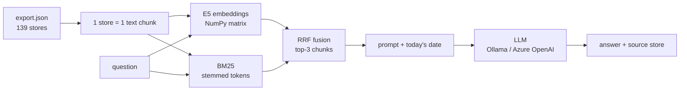

# RAG over O2 stores

A small retrieval-augmented generation prototype that answers questions about O2 Czech Republic stores, such as
*"What is the phone number of the O2 store in OC Metropole Zličín?"*, from the public
[store export](https://www.o2.cz/servis/prodejny-export/export.json).

The goal was the simplest pipeline that solves the task, with every design choice backed by a measurement.
The whole solution is one file, [`rag.py`](rag.py). The notebook [`o2_rag.ipynb`](o2_rag.ipynb) walks through it step by step.

## How it works



1. **Load:** download the JSON once and cache it in `data/export.json`.
2. **Chunk:** each store becomes one short Czech text (name, city, address, phone, e-mail, opening hours, holiday exceptions, note).
3. **Embed:** `intfloat/multilingual-e5-base`, run locally, with `passage:` / `query:` prefixes and normalized vectors stored in a NumPy matrix.
4. **Retrieve:** dense cosine search plus BM25 over lower-cased, diacritic-free, 5-character-truncated tokens, fused with Reciprocal Rank Fusion.
5. **Generate:** a prompt that answers only from the context, says *"Nevím"* when the store is missing and cites the source store. Today's date is computed in code, not by the model.

## Quickstart

```bash
python -m venv .venv && .venv\Scripts\activate          # Linux/macOS: source .venv/bin/activate
pip install torch==2.15.0 --index-url https://download.pytorch.org/whl/cpu
pip install -r requirements.txt

# local LLM (default): https://ollama.com, then
ollama pull qwen3:4b-instruct

python rag.py "Jaké je telefonní číslo O2 prodejny v OC Metropole Zličín?"
python evaluate.py          # retrieval hit@1 / hit@3
python evaluate.py --llm    # + answer check of the full pipeline (~5 min on CPU)
pytest                      # offline tests, no download, no LLM
```

To use OpenAI or Azure OpenAI instead of Ollama, set three environment variables. The code does not change.

```bash
LLM_BASE_URL=https://<resource>.openai.azure.com/openai/v1/   LLM_MODEL=<deployment>   LLM_API_KEY=<key>
```

## Results

Evaluation set: 21 hand-written questions in [`eval/questions.json`](eval/questions.json). They cover both assignment
questions, phone / e-mail / opening hours, Czech inflection ("na Zličíně", "v Šumperku"), missing diacritics, English,
a store without a phone, a public holiday, "tomorrow", and 4 questions outside the data.

| retriever | hit@1 | hit@3 |
|---|---|---|
| dense (E5) | 0.94 | 1.00 |
| BM25, plain tokens | 0.47 | 0.59 |
| BM25, stemmed + stopwords | 0.94 | 1.00 |
| **hybrid (dense + stemmed BM25, RRF)** | **1.00** | **1.00** |

The full pipeline answered **20/21** questions correctly with `qwen3:4b-instruct` on CPU. Answers were checked by keyword and reviewed manually.

**The Sušice store from the assignment is not in the current export.** The correct answer to
*"What are the opening hours of the O2 store in OC Tesco, Hrádecká 1310, Sušice?"* is therefore "I don't know". The system
answers *"Nevím, tuto informaci v dostupných datech nemám."*, even though retrieval returns three other Tesco stores.

## Design decisions

- **RAG, not fine-tuning.** Store data changes, needs exact values (phone numbers) and must be traceable to a source.
  Retrieval is updated by re-indexing in seconds; a fine-tuned model would need retraining and could still invent numbers.
- **One store = one chunk.** A store is a ~200-character self-contained record, so splitting it would only lose context.
- **Hybrid retrieval.** Dense search handles paraphrases and English, but missed "na Zličíně". BM25 handles exact names but
  needs crude stemming for Czech. Each fails on different questions, and RRF combines them without calibrating scores.
- **No vector database.** 139 × 768 floats is 0.4 MB, and brute-force search takes well under a millisecond and is exact.
- **Date in code.** A 4B model cannot reliably resolve "zítra" or "17. listopadu". Passing today's and tomorrow's dates
  fixed those answers (prompt A/B test: 20/24 → 23/24).
- **Swappable LLM.** Any OpenAI-compatible endpoint works. The default is a free, offline local model, so no data leaves the machine.
- **Pinned data snapshot.** `data/export.json` (export of 13 Nov 2026) is committed, so the evaluation is reproducible.
  `python rag.py --refresh "…"` downloads the current export.

## At a larger scale

| Step | This prototype | When it stops being enough | Next step |
|---|---|---|---|
| Ingest | JSON download + cache | many sources, frequent changes | PySpark / Azure Data Factory, scheduled incremental re-index |
| Index | NumPy brute force (~8 ms per 100k vectors) | ~10⁵–10⁶ vectors, filters, concurrency | HNSW index in Azure AI Search |
| Retrieval | dense + BM25 + RRF | ambiguous queries | Azure AI Search hybrid query + semantic reranker |
| Generation | 4B model on CPU (10–25 s) | quality, latency, many users | Azure OpenAI |
| Aggregations | – (top-k RAG) | "which stores in Brno are open on Sunday?" | structured filtering / function calling over the store table |
| Evaluation | 21 questions, keyword check | regressions over time | held-out set, LLM-as-judge, run in CI |

## Limitations

- The evaluation set is small and I tuned the stemmer and the prompt on it, so the numbers are optimistic.
- Holiday exceptions only cover the 7 days included in the export and become stale until the next re-index.
- The 4B local model makes occasional Czech grammar mistakes. A larger model fixes that without code changes.

## Project layout

```
rag.py               the whole pipeline (load, chunk, embed, retrieve, generate, CLI)
evaluate.py          hit@k per retriever and answer accuracy
o2_rag.ipynb         walkthrough with outputs
eval/questions.json  evaluation questions with gold store and expected answer
tests/test_rag.py    offline unit tests
data/export.json     snapshot of the store export
```
